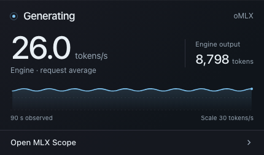
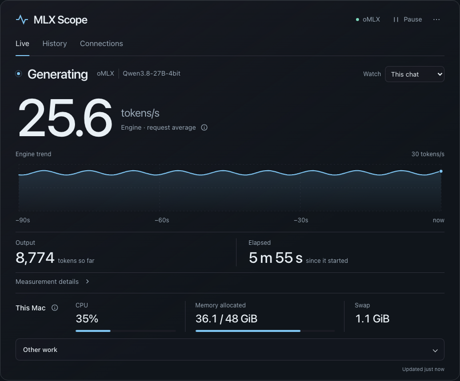
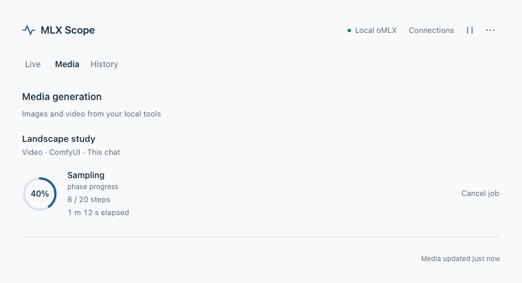

# MLX Scope

**Read-only monitoring for local model runtimes on Apple Silicon, right beside your OpenChamber chat.**

MLX Scope shows how fast your chat is being delivered and what the model engine behind it is doing — generation speed,
prompt progress, memory, and the Mac it runs on. It never sends inference, loads or unloads a model, or starts a
runtime; it reads the status endpoints of the tools you already have.

**New here?** Install it and open a chat. Scope follows it automatically: **Watch** defaults to **Automatic**, which
shows this chat's numbers when they are known and the engine's numbers when they are not. Nothing else needs setup —
readings appear as soon as a supported local server answers.

MLX Scope keeps honest runtime readings beside your conversation. It observes oMLX, Splash in Bionic, LM Studio,
llama.cpp `llama-server`, Ollama, vllm-mlx, mlx-lm and standalone Splash through their supported passive APIs, directly or
behind llama-swap, plus the Mac they run on. Every value identifies its source and how it was measured. Live estimates,
native throughput and completed-reply averages remain separate. Cloud chats receive the optional delivery estimate (`≈`),
labelled **This chat**; it includes network and provider buffering and never borrows a local engine's reading.

| Runtime | Readings |
| --- | --- |
| **oMLX** | Prompt progress, remaining work and time estimate, generation and recent output speed, context and reuse, model activity, cache, process footprint, and a 7/30/90-day usage card "Recorded by oMLX" |
| **Splash via Bionic** *(recommended for Splash)* | Your Splash models with a Splash badge and which one is loaded; live prompt reading and generating; exact tok/s, first-token time, context use and input reuse for each finished response; loaded instances and an Engines card from `lms` |
| **LM Studio** | Available and loaded models, format and context limits; with the `lms` CLI installed, the same live request state and exact per-response figures as Bionic |
| **llama-server** | Health, context, model and slots, with live speed while exactly one slot is busy; server rates and speculative-decoding acceptance with `--metrics` |
| **Ollama** | Which models are resident, their GPU-resident size as Ollama reports it, and when each unloads. Ollama reports residency only |
| **vllm-mlx** | Reported request activity, queue, output and speed; prefill and reuse where the engine exposes usable data |
| **mlx-lm** | Server availability and the available model catalogue |
| **llama-swap** (in front of any of the above) | The ready model's own server, read as that runtime (for example **Splash via llama-swap**); **Loading** while a model starts and **No model loaded** when none runs. Scope never asks llama-swap to load or swap a model |
| **Splash (standalone)** | Real prompt progress with the optional OpenCode companion, plus separate recent prefill and generation speeds across all requests in the main view and Session widget; each stage's actual 2–5-second observation interval and average since engine start in the full view; loaded model and context, idle/generating/recovering state, typical and slow first-token and between-token times from Splash itself, completed/failed counters, vision chips, and GPU (Metal) memory now/peak |

On macOS, every runtime also gets host readings: CPU, memory, swap, the kernel's memory pressure level, the GPU
wired-memory limit, GPU busy and GPU memory as the graphics driver reports them, thermal pressure, and optionally a chip
power estimate. OpenAI-compatible inference does not imply equivalent monitoring; see [Compatibility](docs/COMPATIBILITY.md).

### Using Splash in Bionic

1. Keep Bionic's Local Model API on (for example `http://127.0.0.1:1234/v1`) and add it as a provider in OpenChamber or OpenCode.
2. Make sure Bionic's `lms` command-line tool is installed (`~/.lmstudio/bin/lms`) for live request activity.
3. Open MLX Scope and leave the connection on **Automatic**. It shows "Splash via Bionic". Don't choose the standalone Splash runtime; that is only for `splash serve`.

## Where MLX Scope shows up

- **Session sidebar.** The phase, one reading and **Open MLX Scope**. Prompt progress appears while the prompt is read,
  with a time-left estimate; speed appears while generating or reasoning. Tool use and waiting are explicit, and a
  finished reply says **Last reply**. At most two rows appear only when something happens: a warning such as memory
  pressure, **Slower than usual**, a **Prompt cache miss**, or a note. OpenChamber already shows the selected model, so
  the sidebar does not repeat it.
  **Watch** (Automatic or Engine) and **Pause** sit in OpenChamber's section header; on a host that cannot draw them,
  the same two controls appear inside the section. **Automatic** (default) follows the open chat's provider and model: it
  prefers a runtime reading matched to the chat, then the companion's delivery estimate (`≈`), then the **Engine**
  reading, labelled as such. A match is inferred from runtime activity, not a server-provided chat identifier. **Engine**
  watches the selected connection as a whole. Cloud chats never borrow a local engine's reading or hardware warnings.
  The section samples only while visible and uses lighter Mac probes than the full panel.
- **Rail panel and full page.** One column at every width: This chat leads with the same activity, reading and scope
  menu as the sidebar, with available supporting facts in a separate **Engine** group and a visible **Engine trend** when
  compatible samples exist; **Media** joins the column only while jobs are running or recently finished. The reading never
  goes dark: prompt progress shows supported counts, otherwise the reply's elapsed time, and the previous completed average
  stays below a live reading, dimmed and labelled. Completed results retain their own available output, duration and
  first-token facts; chat step timing stays distinct. **Measurement details** groups deeper engine readings, request
  details, the last reply and a compact **Engine server** strip; engine charts never mix in chat estimates. **Live**, **History** and **Connections** remain
  directly accessible. **Run details** opens current observations and their basis. History reply/turn **Details** opens the same inspector, with eligible reply comparisons and explicit observation gaps.
  History retains recent replies, trends, insights, alerts, and storage. Resizing preserves your selected destination.
  Open the rail from the Session action or the full page from **Extension pages**. Compact mode uses the same quiet
  sidebar presentation.

Colors and typography follow OpenChamber's active theme, including changes while Scope is open. Status and warning
colors use the host's semantic palette; the Session widget lets the surrounding pane's background show through.

A view that is hidden (a rail tab behind another tab, a collapsed section, a closed page, a hidden window) makes no
requests. With several views open, one visible view at a time records history and raises toasts.

The Session sidebar in a dark theme, as Scope 5.0 drew it ([light theme](docs/5.0/assets/standard-session-light.png)). These are simulated preview readings. In 5.1 the controls move to OpenChamber's header and the trace leaves the section.



The full Live instrument keeps the measurement basis beside its value and deeper measurements one click away. Simulated preview data is shown below ([light theme](docs/5.0/assets/standard-instrument-light.png)).



Media keeps measured phase progress separate from chat speed. These 3.1 screenshots use synthetic jobs.



[Connections and guided setup](docs/3.1/assets/connections-light.png) bring runtime, chat and media readiness together.

## Prompt progress for standalone Splash

Splash's normal status readings provide speed but do not provide the current prompt's total size. The optional
[OpenCode companion](bridge/opencode/README.md) enables Splash's own progress messages on existing streaming replies.
With it installed, **Prompt progress** shows the portion read, including tokens reused from cache. Both the Session
section and the full view show the percentage. It clears when the response starts, stops, or becomes uncertain.

The companion is bundled and does not activate automatically. Open **Connections → Enable chat speed** for detected
compatibility and a deliberate setup action, or follow the [manual setup](bridge/opencode/README.md). Setup preserves
existing plugins and JSONC comments and provides **Disable and remove**. It never restarts an active inference session.
Chat delivery estimates are qualified on OpenCode **2.0.25, 2.0.27, 2.0.28, 2.0.29, 2.0.32 and 2.1.1-compaction.1**.
Later 2.0 releases from 2.0.25 and later 2.1 releases from 2.1.1 are **self-checked**: the companion confirms each hook and
event shape it relies on and pauses only the feature whose check fails, with the reason in Connections. A self-check
cannot detect a changed meaning, such as different token accounting, so Connections labels those versions as not yet
qualified. A locally built runtime is accepted only by reviewed identifier, so `2.1.1-compaction.1` works while an
unreviewed suffix does not. Other lines — 2.0.24 and earlier, 2.1.0, 2.2 and later — keep ordinary runtime monitoring
until qualified.
The existing Splash HTTP observer remains separate. New replies acquire observations after activation; an already
running reply cannot acquire them retroactively.

oMLX keeps its existing progress support and does not need the companion. A missing or ambiguous Splash progress
record produces no percentage; Scope does not estimate one from elapsed time or speed.

## Per-chat labels

Readings are labelled **Engine** unless Scope can tell they belong to the open chat. A finished reply is labelled
**This chat** only when all of these hold across it:
- the open chat uses the connection Scope watches, with the same model;
- the runtime counts its requests, and at most one was active at every sample;
- the reply falls inside a turn Scope saw start and finish, with no gap in its samples;
- **Label replies to this chat automatically** is on (the default; History → Storage).

Otherwise the reply stays **Engine** with one reason, such as "This chat uses Splash · Watch Splash". **Limits:**
- Optional **Other work** lists host-reported project activity separately. It does not prove which chat produced an engine reading; another chat alternating requests on the same runtime still cannot be ruled out.
- OpenChamber's own background model calls, such as title generation, can fall inside a labelled turn.
- A view opened mid-turn starts labelling at the next turn.
- Ollama and mlx-lm don't report per-request activity, so their readings are never labelled per chat.

Replies recorded as "Next reply" by Scope 5.0 or earlier are shown as **This chat**.

## Local reply history

Scope keeps a bounded history of the replies it observed while a Scope view was visible, in OpenChamber's extension
storage on this computer: times, token counts, speeds, the model name and the label. It keeps no chat titles, IDs or
content. See [Privacy](PRIVACY.md) for exactly what is stored.
- **History → Storage** has a usage bar, **Keep N days** (30 by default, 90 at most), **Pause recording** and
  **Clear…**, which asks for confirmation.
- The first recording shows "Recording reply history locally · Open Scope to manage".
- History feeds "vs usual" baselines, always shown with their sample count and only from 5 similar replies, and a
  "Slower than usual" flag when the middle of the last 3 replies is 15 % slower (25 % for first-token time). The
  Session section and Live show the flag with what was observed during those replies, such as memory pressure,
  requests queued or a media job running; Scope does not claim these caused it. Standalone Splash replies now carry
  token counts, so they form baselines too. **Copy baseline summary** copies them with models renamed "Model A", "Model B".
- **Prompt cache miss** appears while (and for 5 minutes after) a reply in the open chat re-reads at least 75 % of a
  prompt whose previous version reused at least 4,096 tokens and half of itself. The counts are Splash's own, received
  through the companion; Scope does not know why the cache was not reused.
- Data from Captures and 1.6 observations is kept and counted under **Kept from earlier versions** in History → Storage.
- Replies are written in batches (at most every 5 minutes, at 50 replies, or when the view is hidden), and nothing is
  written while idle. The History chart covers the last 15, 30 or 60 minutes and hatches the stretches when Scope wasn't
  open.

## Alerts while you watch

Runtime lost, model unloaded, memory pressure, swap growth, thermal pressure, Splash recovering, oMLX prefill stall, oMLX
memory guard and "Slower than usual". Alerts are raised only while a Scope view is open and visible: in the view, as a badge on the rail
icon, and as toasts. Toasts are critical-only by default (**Toasts: critical · all · off**), at most one a minute and
three an hour. There is no background watcher, and GPU busy or GPU memory never raises an alert.

## Mac readings

Each reading says where it comes from:
- macOS memory pressure (the kernel's level), swap, and the GPU wired-memory limit;
- GPU busy and GPU memory, both **driver-reported**. GPU memory includes other apps and reserved memory, so it is not
  model size;
- macOS thermal pressure, with a warning from "Heavy";
- the oMLX process's memory footprint;
- optional chip power (CPU+GPU+ANE), labelled an **estimate**, with tokens per joule. It needs
  [macmon](https://github.com/vladkens/macmon), which you install yourself. It includes all apps and is not wall power.

## Install

Scope 5.1 requires **OpenChamber 2.4.0 or newer** and is built against SDK 2.5.0. Keep **Scope 5.0.0** on OpenChamber 2.3.x and **Scope 4.0.1** on older hosts. See [Compatibility](docs/COMPATIBILITY.md) for the exact evidence and upgrade requirements. Runtimes must run on the same computer as the OpenChamber server; Mac diagnostics require macOS.

1. In OpenChamber, open **Settings → Extensions** and add this repository's `release` branch by its Git URL:
   `https://github.com/mikebuckets171/mlx-scope-openchamber#release`. The `release` branch holds exactly the published
   package, so **Check for updates** brings each release in place and keeps your History, preferences and permissions.
2. Review OpenChamber’s local-service and sessions permissions. The package contains built JavaScript and needs no build toolchain.
3. Open **MLX Scope** from the Session sidebar. It follows the selected chat automatically.

Each release also attaches **mlx-scope-openchamber-<version>.zip**. **Installing a ZIP over an existing Scope replaces
it, and OpenChamber deletes the extension's storage when it does:** your History, baselines and preferences. Prefer the
Git install. If you switch an existing ZIP install to Git, first copy
`~/.config/openchamber/guest-storage/mlx-scope.json` somewhere outside `~/.config/openchamber/extensions/`, then put it
back after installing and before opening Scope.

Scope discovers supported existing connections. Native readings start immediately when available. **Connections** shows what is connected and gives one action for additional tracking: **Enable chat speed** or **Enable detailed media progress**. Installation and readiness are separate; a helper waiting for its owning application to start is labelled accordingly. Scope never restarts an application or generates test work.

The column shows chat and engine readings, then **Media** while local image/video jobs are active or recently finished. **History** retains existing observations. In the compact Session section, this chat’s media job comes first, with a count of other jobs. A ring shows the measured progress of the named phase and the percentage is written beside it; an older reading says **Last reported** and stays still. A finished job shows the time its source reported, such as **Finished 9:38 PM** — Scope never estimates when a render will end. Renders from Draw Things' command-line tool appear with their phase and step count, without setup. [Media support and setup](docs/MEDIA.md) explains supported sources and progress units.

Use Connections → Advanced only when automatic discovery cannot identify a custom installation. Existing provider credentials stay in their owning configuration. Enterprise deployments may require the administrator to allowlist this repository.

Git updates preserve existing preferences and observations. **Scope 5.1 asks for approval once** because it declares fewer permissions: `sessions` only, without `shells`, the `/scope` command or a background page. **Chats and subagents** under **Other work** in Live starts disabled; approving the update does not enable it. These host readings remain separate from engine measurements. The service executable permissions are unchanged. After updating, choose **Connections → Update chat speed** once to load companion 3.5.0; later OpenCode 2.0 and 2.1 updates need no Scope action. If extension/service versions differ after an update, reload the extension in Settings → Extensions; generation backends remain independent.

### What Scope asks you to approve and why

| Entry | What Scope runs | Why |
|---|---|---|
| Local service (`service/main.js`) | Runs under your account while a Scope view needs readings | Reads local runtime APIs on loopback and runs the commands below. Keeps runtime readings in memory, writes bounded private chat-demand metadata, and changes companion files/configuration only after Enable or Disable |
| `/usr/bin/vm_stat` | `vm_stat` | Memory page counts: used, wired and compressed memory (as in 1.x) |
| `/usr/sbin/sysctl` | `sysctl -i vm.swapusage kern.memorystatus_vm_pressure_level iogpu.wired_limit_mb` | Swap, the kernel's memory pressure level and the GPU wired-memory limit (1.x read swap only) |
| `/usr/sbin/ioreg` | `ioreg -r -d 1 -w 0 -c IOAccelerator` | GPU busy and GPU memory, as the graphics driver reports them |
| `/usr/bin/notifyutil` | `notifyutil -g com.apple.system.thermalpressurelevel` | macOS thermal pressure level |
| `/usr/sbin/lsof` | `lsof -nP -iTCP:<port> -sTCP:LISTEN -t` | Finds the process listening on the oMLX port. oMLX only |
| `/usr/bin/footprint` | `footprint -p <pid>` | That oMLX process's memory footprint, where oMLX's model memory lives. The process ID never leaves the service |
| `~/.lmstudio/bin/lms` | `lms log stream -s server --json --port <port>`, `lms ps --json --port <port>`, `lms runtime ls --port <port>` | Live request activity, loaded instances and engine versions for Bionic and LM Studio. It runs only after LM Studio has answered, and never starts LM Studio or Bionic |
| `~/.cache/lm-studio/bin/lms` | The same three commands | The same, for LM Studio's older install location |
| `/opt/homebrew/bin/macmon` | `macmon pipe -i 1000` | Optional chip power estimate, only if you installed macmon with Homebrew. Scope never installs it |
| `/usr/local/bin/macmon` | The same | The same, for a macmon installed under `/usr/local` |

- **Optional host capability:** `sessions` for current-project running/waiting chats and host-reported subagents. It is disabled initially and subscribes only while Live is visible. Scope never sends a prompt through it. Per-chat measurement labels still use the existing open-chat observations.
- **Never used:** `sudo`, `osascript`, `powermetrics` or `pmset`.
- Each command runs by absolute path, without a shell, and only with the arguments shown; a test checks the argument
  list for each binary, and packaging checks that the service uses exactly these paths. OpenChamber does not sandbox a
  service, so this list is Scope's promise, enforced in its own code; see [Security](SECURITY.md).
- `lms` runs only from the two locations above. An LM Studio home moved with `~/.lmstudio-home-pointer` keeps its
  inventory view, without live activity.
- Permission changes are shown by OpenChamber when updating. Scope cannot approve its own service.

## What the readings mean

Every reading identifies its scope and basis. **Engine** readings describe the whole runtime; **This chat** readings are
runtime observations matched to the open chat, the companion's delivery estimate (`≈`) or a completed-step average. Hardware readings describe the whole Mac.
The [metric definitions](docs/METRICS.md) explain source precedence and matching limits. Values the runtime doesn't
report are left out. Idle time is a gap in a chart, never a zero. Held or stale readings are labelled, and every value
that isn't reported directly carries its basis: derived, observed, last observed or estimate.

oMLX primary DFlash output uses fresh token counters to calculate clearly labelled **recent output** speed. Before output
arrives, it shows processing without inventing prefill progress.

Comparisons are observations, not controlled benchmarks or proof that a request finished successfully. Prompts, cache
states, and competing workloads can change a comparison. [Metric definitions](docs/METRICS.md) explain the limits.

## Lightweight passive monitoring

Vanilla TypeScript, the official OpenChamber SDK, and a host-managed local service. No UI framework, chart library,
inference requests, or separate daemon. The service reads a runtime only when a visible view asks, shares one reading
between views, and holds at most an hour of trend data in memory. Hidden and paused views make no requests; a minute
after the last view closes the service makes no requests and runs no commands, and after ten minutes without a view
it exits until OpenChamber starts it on the next request. Histories, responses, and storage are bounded.

The approved service runs under the OpenChamber user account and reads local configuration, runtime APIs, and fixed
macOS diagnostic commands. Monitoring is passive; managed setup and exact media cancellation require deliberate actions. These boundaries are enforced in code, not an operating-system sandbox. There is no analytics
service. See [Privacy](PRIVACY.md) and [Security](SECURITY.md).

## Project status

MLX Scope is a focused community-maintained project. Runtime compatibility depends on supported upstream interfaces and
maintainer availability. The MIT license allows the community to fork and adapt it.

## Development

```sh
bun install --frozen-lockfile
bunx playwright install --with-deps chromium webkit
bun run check:all
```

Use Bun 1.4.2 (`.bun-version`): the committed `panel/main.js` and `service/main.js` are its output.
Checks include an extracted-package startup under Node without `node_modules`, interaction tests in Chromium and WebKit,
and synthetic fixture corpora for every runtime. Splash support follows its passive 1.1 `/status` contract; runtime
versions are compatibility anchors, not minimum requirements. See
[Contributing](https://github.com/mikebuckets171/mlx-scope-openchamber/blob/main/CONTRIBUTING.md) and
[Architecture](docs/ARCHITECTURE.md) for builds and sampling limits.

[MIT license](LICENSE) · [Third-party notices](THIRD_PARTY_NOTICES.md)

Independent community project; not affiliated with the runtime projects, OpenChamber, or Apple.
