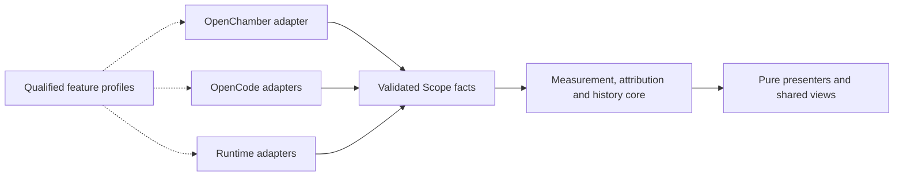

# MLX Scope 4 — product and compatibility scope

Status: scoped proposal. The agreed direction is **a leaner, clearer monitor with deeper insight into local runs**, designed to adapt to future OpenChamber and OpenCode updates. Skip 3.3 as a release and carry its useful completed work into 4.0. Implementation details below remain proposed; this document does not authorize installation, a version bump, a tag or a release.

Scope 4 should make three questions easy to answer: what is happening now, what Scope actually observed during a run, and how those measurements compare with similar observations. Its long-term design should concentrate upstream changes in small adapters, qualify features independently and explain unsupported measurements. Future semantic changes can still require code changes and a new release.

**Primary design priority: consistent, compact and intuitive panels.** Every surface should feel like the same product, make the current state easy to understand and use space according to the content actually available. Panel consistency and removal of empty reserved space are release requirements. Compatibility architecture and deeper insight must support this experience while preserving the lightweight budget.

**Product shape**

Keep the Session glance quiet: current phase, one relevant reading, an available supporting fact and a route to detail. Use the same run inspector from Live and History. Show media alongside local chat activity when there is relevant work. Consolidate existing reporting instead of adding another permanent dashboard or collection loop.

| Workflow | 4.0 commitment | Evidence boundary |
| --- | --- | --- |
| Now | Consistent glance and page hierarchy: current work, a labelled retained result at rest, or concise connection/measurement guidance. | Stale and unsupported readings never appear current. Regions either show true content or collapse. |
| Run details | Inspect available timing, output, input reuse, context and attribution. Show recorded memory pressure, swap and thermal conditions when available. Explain known observation gaps. | Use facts retained for that record. Older history does not acquire reconstructed stages or invented coverage percentages. Host conditions are observations, not established causes. |
| Comparable runs | Compare eligible recorded replies or use the existing comparable-history baseline. Explain grouping, sample count, deltas and differences that limit interpretation. | Qualify each metric separately. This is observational comparison, not a controlled benchmark or model-quality ranking. |
| Compatibility | A compact explanation of which measurements work, which are unavailable and why; show diagnostics and instructions for explicit CLI qualification. | Support status and current activity are separate. A fresh heartbeat proves neither attribution correctness nor token semantics. |

“Run” is a presentation umbrella. Engine replies, attributed chat turns and media jobs retain distinct identities, clocks and meanings. A matching model is insufficient to merge them. The initial inspector is useful with existing measurements; a complete phase timeline is not required for 4.0.

**Panel consistency and useful space**

Apply one shared visual system across the Session/Work Status glance, full page, media, server, connections/setup, History, Captures and run details. Adapt density to the surface while preserving the same meanings and interaction patterns.

- **Consistent hierarchy.** Use the same order: identity and state, primary reading, supporting facts, then relevant actions. Share typography, spacing, metric formatting, labels, status colors, borders and control treatments. The same fact must have the same name, unit, precision and freshness meaning wherever it appears.
- **Content determines height.** Remove unused metric rows, chart frames, columns and their associated padding, margins and gaps. Do not reserve a tall card or minimum height for a reading that is absent. A heading, border or empty wrapper alone does not count as useful content. Explicit form controls and labelled progress count as content when they serve the current state.
- **Compact, useful empty states.** When setup or explanation is needed, show one concise reason and a clear next action when one exists. Empty History and Captures need compact guidance; idle, paused, unloaded, offline and partially supported states need truthful status. Preserve errors and important limitations without repeating the same explanation in several cards.
- **Readable spacing.** Keep deliberate spacing for grouping, legibility and touch/focus targets. Do not stretch cards to fill the viewport or insert decorative metrics, skeletons, charts or repeated copy to occupy space. Unused viewport below naturally sized content is acceptable; unexplained reserved space inside panels is not.
- **Predictable interaction.** Keep navigation and action placement consistent. Secondary detail opens through a clearly labelled disclosure or the shared inspector. Preserve keyboard focus and expanded state. Routine numeric updates should not reorder sections or move controls; a real change in available content may resize the affected region.

Review layouts by state, including transitions: connecting → active → completed → idle, model unloaded, paused, stale/offline, reconnect, failed setup, empty history/captures and partial media/progress data. Each transition must retain the user's context, explain the state and leave no empty reserved region behind. Motion follows real changes, respects reduced motion and never runs in hidden frames.

Before adding deeper insight, produce a state/surface inventory and visual review of the shared panel patterns. Record intentional differences between surfaces. Add browser assertions for every applicable mock-state/surface pair, checking the actual measure, evidence, chart, support and action regions rather than just outer-card height. An absent optional region and its exclusive spacing must collapse; a compact explanatory state must have natural height. Verify narrow and wide layouts, both themes, enlarged text, keyboard use and transitions. This is an implementation acceptance gate; it has not been newly executed by this scoping update.

**Foundation: isolate what changes**

Build on the existing contracts, collectors, attribution, history, bounded caches, presenters and tests. Refactor incrementally behind tested boundaries; preserve features throughout.

| Boundary | Responsibility | Rule |
| --- | --- | --- |
| OpenChamber host adapter | Ready/context/theme, session identity and lifecycle, visibility, service transport, storage, navigation and surface sizing. | Domain code consumes Scope-owned types. One owner normalizes replay, reconnect and disposal. Keep any SDK-internal theme dependency isolated and explicitly tested. |
| OpenCode event adapters | Translate qualified upstream dispatch, delivery and lifecycle events into a small Scope-owned vocabulary. | Separate HTTP matching, experimental WebSocket matching, delivery accounting and prompt-progress instrumentation. Each feature has independent registration, cleanup and qualification. |
| Configuration/install adapter | Read supported provider layouts and manage the existing companion installation/update path. | Distinguish installed files from loaded revision. Unknown layouts or reload behavior require an explicit manual path; do not guess, rewrite unfamiliar configuration or restart applications. |
| Runtime adapters | Normalize each engine/media source's reported facts and capabilities. | Preserve native runtime measurements when an independent companion feature fails. Do not infer backend capabilities from the presence of a proxy. |
| Stable core | Measurement meaning, attribution, freshness, history eligibility, comparisons and presentation inputs. | No raw SDK types, upstream event names or scattered host-version checks. Preserve source, identity, basis, clock and available coverage information. |

The current compatibility policy needs this separation: exact OpenCode `2.0.25` eligibility appears in hook registration, demand, the service reader, setup and qualification scripts. An optional hook failure currently rolls back otherwise usable companion registrations. Host SDK shapes also reach several panel components. These are bounded refactoring targets, not a reason to replace the application.

OpenChamber's SDK documents replayed ready/context notifications and an API-version contract. The adapter must mount once, update context idempotently and handle errors without duplicate subscriptions. Continue using the supported bundled guest format and pinned dependency; do not introduce an unqualified loader or SDK fork. [Host API](https://docs.openchamber.dev/sdk/host/), [upstream SDK contract](https://github.com/openchamber/openchamber/blob/main/packages/sdk/README.md).

OpenCode's V2 plugin API and its experimental hooks need separate treatment. The migration documentation explicitly describes API changes that require implementation changes. A broad version range or a method's presence cannot establish compatible event semantics. [V2 plugins](https://dev.opencode.ai/v2/docs/build/plugins/), [V1-to-V2 migration](https://dev.opencode.ai/v2/docs/build/plugins/migrate-v1).

**One compatibility policy, qualified per feature**

Use a small, locally bundled registry shared by the companion, reader, setup UI and qualification tools. Each profile identifies the tested upstream contract/version range, adapter revision, supported features, prerequisites, semantic checks, invalidation rules and qualification evidence. Keep product version, companion package version, upstream adapter profile and Scope wire-schema version independent.

Declare support only for tested profiles. A candidate-testing mode may run an adapter against a new upstream version in isolation; passing familiar field shapes does not automatically authorize production support. Tolerate harmless extra fields, but withdraw dependent facts when units, ordering, clocks, identities or completion boundaries are unknown. Request instrumentation remains disabled for an unqualified path.

Start with a finite matrix: selected current and minimum supported OpenChamber builds, the current qualified OpenCode profile, and at most one previous protocol profile when its maintenance and resource cost remain affordable. Record exact builds in receipts. Existing version anchors are starting evidence, not automatic Scope 4 qualification. Do not promise every host/runtime/transport combination or all future versions.

Keep **qualified / unqualified / unavailable** separate from **waiting / observing / stale**. Setup should also distinguish installed, loaded and live. Explain a missing fact once, in context, rather than reserving empty cards.

| Failure or change | Required behavior |
| --- | --- |
| Unknown delivery/token semantics | Withdraw affected chat estimates and calibration; retain independently valid engine facts. |
| Missing or changed WebSocket hook | Disable WebSocket attribution; retain separately qualified HTTP observation. |
| Missing session identity or lifecycle boundaries | Offer engine-scoped facts only for a separately identified local connection or explicit Engine view. Never attach local measurements to a cloud chat or trigger local collection because chat identity was lost. |
| Storage unavailable | Keep monitoring where possible; explain recording is unavailable and preserve existing data. |
| Unknown configuration or managed-reload behavior | Explain manual setup or installed-but-not-loaded status. |
| Host service transport fails | Explain the affected monitoring is unavailable. Engine readings inside that frame require a working bridge. |
| Host cannot mount the extension | No in-panel fallback can be guaranteed; retain a documented recovery/diagnostic path. |

The companion currently includes both passive observation and optional request instrumentation for prompt progress. These are separate compatibility features. Retaining basic observation must never accidentally enable an unqualified request change.

**Upgrade qualification as a maintained tool**

Provide one standalone developer/user CLI entry point that selects a candidate profile, runs the relevant isolated checks and produces a sanitized feature report. The panel shows status and instructions; it does not acquire arbitrary executable access or launch candidate hosts through the extension service. Reuse the existing replay, HTTP, WebSocket and managed-update harnesses. Default qualification uses synthetic fixtures; it does not generate a real reply, download a model, install a candidate or restart a live host.

1. Record host/runtime identity, adapter and companion hashes, fixture revision and the features under test.
2. Replay normal, duplicate, reordered, malformed and missing-boundary events; check identity changes, mixed writers and timestamps.
3. Run isolated integration cases where applicable: HTTP/WS paths, cached socket reuse, retries, concurrency, provider/model changes and update/reload behavior. Test the packaged artifact as well as source fixtures.
4. Exercise OpenChamber ready replay, reconnect, missing lifecycle/model fields, service permission loss, disposal and visibility. Inject host events while hidden so the test detects hidden rendering and duplicate subscriptions.
5. Re-run privacy, packaging and resource gates. Produce passed, failed, skipped and unqualified outcomes per feature, with limitations.
6. Review the evidence and add the accepted profile through an ordinary code change. Invalidate qualification when a relevant runtime, adapter or contract changes.

A live proof is a separate, user-driven step. In particular, the ordinary local reply needed to prove llama-swap prompt percentage still requires the user's participation. Do not run it automatically. Existing native WebSocket cancellation proof is incomplete; unit interruption coverage must not become a blanket “WebSocket qualified” claim.

No remote executable profiles, automatic dependency upgrades, background compatibility watcher or dynamic plugin framework are needed. Future updates should normally touch an adapter, its profile and fixtures. A real domain-semantic change can also require core changes; the architecture must make that review explicit.

**Deeper insight without more collection by default**

Build the initial inspector and comparisons over existing completion, attribution, capture and ledger data. Compute detail work when opened or when its inputs change. Keep history aggregation out of routine polling. Consolidate metric rows and explanations so the richer view earns its bundle budget.

- Preserve each available fact's source, scope, basis and freshness. Missing historical provenance or coverage remains unknown.
- Do not equate time to first token with queue or prompt-processing time. Partition timings only when boundaries and clocks support it.
- Turn wall time outside observed engine intervals includes tools, orchestration, permission waits and other waiting. It is not exact tool execution time.
- Distinguish confirmed completion from last-observed results, and native engine rates from companion delivery estimates.
- Apply the existing per-metric eligibility guards. Estimates, overlap, aggregate records and last-observed values are not interchangeable with qualified reply metrics.
- Reuse existing baseline rules: up to 50 eligible observations over 14 days, excluding the current 30 minutes; five samples for median, ten for p90; grouping by runtime/model and relevant context or uncached-input bucket. Explain remaining configuration/hardware/workload differences.

The presentation MVP adds no collection endpoint, timer, worker, dependency or host permission, including session-history access. No prompt text, tool payloads or raw chat identifiers are added to stored detail or exports.

**Contracts and stored data must survive updates**

Keep current wire/storage versions when their meanings remain unchanged. Optional fields may extend a contract without redefining existing fields. A breaking meaning needs an explicit contract revision. Accept only qualified producer/profile combinations; a producer's self-declared capability is insufficient.

Test the finite panel/service/companion combinations that an update can leave running together. Reject unknown major formats without overwriting or deleting them. Any later migration must be deterministic, bounded, resumable and quota-aware, preserving the previous namespace until validation succeeds and documenting rollback limits. Product version 4 does not itself require a storage reset or a schema rewrite.

**Carry-forward work and open decisions**

The unreleased foundation already contains the full-page and cross-surface fill/fold fixes, motion bookkeeping changes and bundle consolidation. At the scoping checkpoint, the panel is **303,615 bytes**, down from 307,611, with the **304,000-byte ceiling restored**. Type checks, unit/bridge tests, reproducible packaging and 468 browser cases passed on that candidate. The live installation is unchanged.

Resource qualification is still open. Repeated renderer medians improved, but individual windows and service measurements exceeded targets. Retain failed receipts and resolve the inconsistencies during the first implementation milestone; this scope does not declare performance acceptance complete.

| Remaining item | Scope 4 disposition |
| --- | --- |
| llama-swap prompt percentage | Qualify the exact upstream path; requires the user-driven live reply. Proxy support alone proves no percentage capability. |
| Model-load duration | Candidate for a later 4.x increment after transition semantics, connection generation and partial sampled intervals are defined. Current loading state conflates starting and stopping. |
| One-command requalification after a model swap | Preserve as a separate workflow candidate. Reuse reporting where appropriate, but do not conflate a model measurement with host/protocol qualification or silently trigger inference. |
| Single-sampler ComfyUI ETA | Separate media increment, qualified for that phase and workflow shape. Do not generalize to whole-job ETA. |
| Listening grace | Conditional on measured service/child overhead; it cannot recover facts from an unobserved interval. |
| Full phase history and exact tool intervals | Later telemetry decision requiring authoritative boundaries, bounded retention, versioned persistence and migration. Existing history cannot reconstruct it. |

**Delivery sequence and acceptance**

1. **Panel design and headroom.** Carry the completed fixes forward, audit every state and surface, establish shared hierarchy/spacing/empty-state patterns and settle outstanding resource failures. Inventory feature capabilities and define the finite support matrix.
2. **Consistent panel foundation.** Apply the shared patterns to existing surfaces and remove empty reserved regions before expanding run detail. Pin geometry, transitions, keyboard focus and responsive behavior; preserve truthful states and useful spacing.
3. **Compatibility boundaries.** Centralize host event ownership and compatibility policy. Extract adapters incrementally, make optional features independently disposable and add candidate qualification/reporting. Pin import boundaries and feature-specific fallback in tests.
4. **Deeper local-run views.** Add the shared inspector, qualified comparisons and concise coverage explanations using the same panel patterns and existing data. Preserve supported runtimes, captures/history controls, themes, navigation and accessibility.
5. **Visual review, upgrade rehearsal and release qualification.** Review all surfaces together for consistency and unexplained gaps. Test compatible/incompatible upstream changes, mixed component versions and storage recovery. Run the full final-artifact gate and record explicit limitations. Installation, version bump, tag and release remain separate user decisions.

| Gate | Required result |
| --- | --- |
| Bundle | Panel below 304,000 bytes; service at most 250,000; background at most 25,000. Additional panel assets count toward an aggregate code budget; relocating bytes is not a saving. Current service/background sizes are 248,038/24,129, so consolidation must create headroom first. |
| Service CPU and memory | Include every descendant process. No-view at most 0.07%, idle/glance at most 0.68%, active at most 1.9% of one core; service RSS at most 132 MiB. Two consecutive qualifying runs; keep glance at most 0.62% as a separate stretch target. |
| Process/storage work | Preserve existing bounded storage, leader-only writes and spawn ceilings: idle 24/min, active 36/min, glance 18/min; child cleanup within the existing 65-second bound. |
| Renderer/startup | Same-fixture A/B against the retained reference; target live renderer approximately 1.62–1.70% or lower, hidden approximately zero. Preserve startup parity and one snapshot request at mount; the earlier lifecycle timeout was a test race, not a startup regression. |
| Hidden and closed views | Closed detail adds no requests, child processes or writes. Hidden surfaces stop polling, animation, derived rendering and unnecessary subscriptions after bounded cleanup; allow the existing limited hide flush. Test with incoming host events. |
| Panel consistency | Shared hierarchy, labels, units, spacing and controls across all surfaces. Review the state/surface inventory before adding detail features and again on final layouts. Secondary detail has a clear route; routine updates preserve control order, keyboard focus and disclosure state. |
| Truth and geometry | Every applicable mock-state/surface pair and important transition, narrow/wide layouts, both themes, enlarged text, reduced motion, stale/partial/overlapping records and mixed bases. Missing optional regions and their exclusive spacing collapse. Explanations have natural height; no empty chart frames or reserved metric rows. Preserve readable spacing. Reduced motion is instant; hidden frames animate nothing. |
| Compatibility | Optional-hook failure leaves unrelated features usable; harmless fields are tolerated; changed semantics invalidate only dependent facts. Repeated ready/disposal produces no duplicate subscriptions or leaks. |
| Functional/package | Type/privacy checks, unit and bridge suites, helper checks, reproducible build/package verification and the complete browser suite on final artifacts. |

All resource receipts are CPU-only synthetic fixtures. They do not establish native host overhead, GPU/compositor savings, real inference slowdown, universal runtime support or causal explanations of a slow run. A passing fixture profile and live proof must remain separately labelled.

**Outside 4.0**

Runtime/model controls, automatic tuning or benchmarking, queue scheduling, autonomous monitoring, new cloud work, chat-content storage, history across reinstall, mid-reply recovery, causal “why slow” claims, exact per-chat hardware cost and universal whole-workflow progress remain excluded.

The proposed 4.0 is ready when every panel is consistent, compact and easy to use; a user can move from the glance to a trustworthy explanation and fair comparison; routine upstream changes are contained; and the extension meets its resource budgets.
